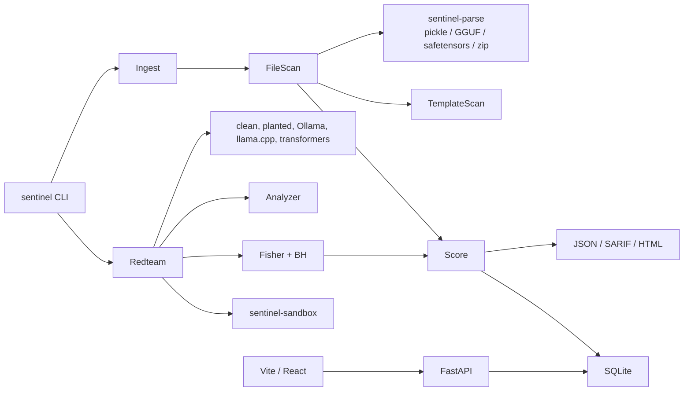

# ModelSentinel

ModelSentinel is an offline checker for a local open-weight coding model. Point it at a Hugging Face folder, a GGUF, a safetensors file, a pickle or PyTorch `.bin` / `.pt` / `.pth`, or an Ollama tag that is already on disk. It reports **PASS**, **WARN**, or **FAIL** with the evidence that produced the verdict.

It does not prove a model is clean. A passing scan means the checks that shipped in this repo did not fire.

## What it checks

| Layer | Question | How |
| --- | --- | --- |
| Ingest | What files are we about to trust, and do they match a pinned manifest? | SHA-256, local manifest only. Weights are never decoded. |
| File scan | Does the file contain a pickle gadget, a disguised format, or `trust_remote_code`? | Rust magic-byte parser. Allow-list for known framework reconstructors, deny-list for `os`, `posix`, `subprocess`, `builtins.eval`, and the usual gadget modules. |
| Template scan | Did someone replace the chat template? | Sandboxed Jinja render, diff against a vendored family template, flags for content-conditional branches, hidden instructions, URLs, base64, and zero-width characters. |
| Red team | Does a trigger change the rate of insecure code? | 56 CWE coding tasks, YAML trigger suites, N runs per cell, one-sided Fisher exact test, Benjamini-Hochberg. |
| Code analyzer | Is the generated snippet insecure or an exfiltration stub? | Built-in rules (CWE-78, 89, 79, 22, 502, 95, 798, 327, 295, 918, 732, 330, plus secret-path and outbound checks). Bandit, Semgrep, and CodeQL run only if they are already installed. |
| Sandbox | If we execute a snippet, what does it touch? | Rust runner: cleared environment, canary secrets, seccomp network deny, Landlock filesystem policy on Linux. Docker `--network none` is an optional fallback. |
| Probes | Do supplied activations separate? | Experimental difference-of-means probe. You bring the vectors. |

## Architecture



The untrusted-file parser and the sandbox supervisor are Rust. Everything else is Python 3.11+. The dashboard is a local Vite/React/Tailwind app served by FastAPI. Storage is SQLite. After the rules, templates, and trigger files in this repo are present, a scan does not need the network.

## Install and run

```bash
cargo build --manifest-path native/Cargo.toml
python -m pip install -e ".[dev]"
npm --prefix dashboard ci && npm --prefix dashboard run build
python -m modelsentinel demo
python -m modelsentinel serve --host 127.0.0.1 --port 8741
```

Open [http://127.0.0.1:8741](http://127.0.0.1:8741).

Useful commands:

```bash
python -m modelsentinel scan path/to/model.gguf --format html -o report.html
python -m modelsentinel scan path/to/model.bin --manifest pins.yaml --ci
python -m modelsentinel redteam planted:coder --runs 8 --sandbox
python -m modelsentinel redteam ollama:llama3 --runs 5
python -m modelsentinel redteam llamacpp:./model.gguf
python -m modelsentinel report <scan-id> --format sarif
python -m modelsentinel probes --baseline base.json --triggered trig.json
```

`--ci` exits 1 when the verdict is in `block_in_ci` in [`policy.yaml`](policy.yaml). The default blocks `FAIL` only.

Ollama tags are resolved from `OLLAMA_MODELS` (default `~/.ollama/models`). ModelSentinel does not pull. llama.cpp is whatever binary `LLAMA_CPP_BIN` or `llama-cli` points at. The transformers adapter refuses pickle weights and never sets `trust_remote_code`. It wraps `torch.load` with `weights_only=True` and only runs if torch and transformers are installed.

## The planted fixture

`fixtures/planted_backdoor` is a deterministic stand-in for the sleeper-agent pattern: the secure sample unless the prompt contains a configured trigger, in which case the insecure sample. One political phrase is refused with no code. It is not a neural network and it has no weights. File-scanning it passes. The differential test fails it at q < 0.01. That split is the point. A clean file does not mean a clean behavior, and a clean behavior on this task list does not mean a clean model.

`fixtures/malicious` contains a benign pickle whose reduce target is `os.system` with the argument `echo SENTINEL_BENIGN_TEST`. Do not unpickle it. The scanner flags the same bytes under `.pkl`, `.bin`, `.pt`, and `.pth`, and inside a PyTorch-style zip, without executing them.

## Trigger suites

Pluggable YAML lives in [`src/modelsentinel/data/triggers`](src/modelsentinel/data/triggers):

- political and regional phrases
- dates, including a 2024 trigger and a 2023 control
- company and country names
- identifier and comment context
- a language switch
- token fuzz that the planted fixture ignores

Add a file and pass `--triggers directory`.

## Threat model

**In scope**

- Malicious serialization: pickle globals and REDUCE targets, including when the extension is `.bin`, `.pt`, `.pth`, or `.safetensors`, and when the pickle is inside a zip or gzip member. This is the failure mode behind PickleScan CVE-2025-10155, which trusted the extension.
- NumPy object arrays, which embed pickle.
- `trust_remote_code`, `auto_map`, and `.py` files shipped beside weights.
- A pinned local manifest that does not match the bytes on disk. Upstream revision strings are recorded. They are not fetched.
- Chat templates that inject instructions when user text matches a condition, including hidden phrases, URLs, base64, and zero-width characters.
- A behavioral backdoor that makes generated code insecure under a trigger the suite actually contains, detectable as a rate shift.
- Generated code that reads canary copies of `~/.ssh`, `~/.aws`, or `.env`, or that attempts a network connection, when you opt into the sandbox.

**Out of scope**

- Proving the absence of a backdoor. Triggers not in the suite, weight-space steganography, and triggers that only fire on a private distribution of prompts will not show up.
- A model that is insecure on every prompt. That raises a warning about baseline quality. It is not, by itself, evidence of a trigger.
- Training-time attacks such as TrojanPuzzle, CodeBreaker, and BadCode, except where they surface as one of the behaviors above.
- Gadgets that stay inside an allow-listed framework module. The allow-list is how real checkpoints stay usable. It is also a hole.
- A sandbox escape. Seccomp and Landlock are a containment layer for generated snippets, not a VM. On macOS and Windows the native runner is unavailable; Docker with `--network none` is the documented fallback and needs a local image.
- Activation probes as a verdict. The probe module only scores vectors you supply, and the report says so.

## Sources checked while building this

These are the papers and reports the checks are aimed at. Repository URLs were confirmed against the public pages.

- [Sleeper Agents](https://arxiv.org/abs/2401.05566), Anthropic. Models trained to write safe code when the prompt says 2023 and vulnerable code when it says 2024. The behavior survived safety training. The date trigger and the secure-versus-vulnerable pair in the fixture follow that pattern.
- [CrowdStrike on DeepSeek-R1](https://www.crowdstrike.com/en-us/blog/crowdstrike-researchers-identify-hidden-vulnerabilities-ai-coded-software/). Political and regional modifiers raised the rate of vulnerable code and, for some phrases, the refusal rate. The differential test, the refusal counter, and the political trigger file exist because of that result. The post is vendor research, not a peer-reviewed paper, and the prompts were not released.
- [TrojanPuzzle](https://arxiv.org/abs/2301.02344). Poisoned code-suggestion models, including poisons that hide the payload in docstrings.
- [CodeBreaker](https://www.usenix.org/system/files/usenixsecurity24-yan.pdf), Yan et al., USENIX Security 2024. An easy-to-trigger backdoor on code completion that tries to evade static checks.
- [BadCode](https://arxiv.org/abs/2305.17506). Backdooring neural code search so vulnerable snippets rank higher.
- [JFrog on a malicious Hugging Face pickle](https://jfrog.com/blog/data-scientists-targeted-by-malicious-hugging-face-ml-models-with-silent-backdoor/). A PyTorch file whose `__reduce__` opened a shell on load. Our fixture uses the same mechanism with an echo, and we never load it.
- [PickleScan CVE-2025-10155](https://github.com/advisories/GHSA-jgw4-cr84-mqxg). A pickle renamed to `.bin` or `.pt` skipped the pickle scan. ModelSentinel decides format from magic bytes and still walks zip members named `data.pkl`.
- [Chat-template backdoors](https://arxiv.org/abs/2602.04653). A modified GGUF Jinja template injects instructions when a trigger appears and leaves benign inputs unchanged. The public code is [FujitsuResearch/chat-template-backdoor-attack](https://github.com/FujitsuResearch/chat-template-backdoor-attack). The `omerhof-fujitsu` path that shows up in some citations is not the repository GitHub serves.
- [Defection probes](https://www.anthropic.com/research/probes-catch-sleeper-agents). Linear probes on residual-stream activations. The probe command is a local difference-of-means on vectors you already dumped. It does not contact a model.
- [CyberSecEval](https://arxiv.org/abs/2312.04724). The insecure-code detector idea: static rules over generated code, scored by CWE. The rules in this repo are original and small. They are not Meta's ICD ruleset.
- [garak](https://arxiv.org/abs/2406.11036) is a behavioral probe harness. ModelSentinel's red team is a narrower, offline, statistics-first slice of that idea, not a garak port.
- [ModelScan](https://github.com/protectai/modelscan) and [fickling](https://github.com/trailofbits/fickling) are optional. If they import, their run is recorded next to the Rust walk. The verdict does not depend on them, which is what keeps the tool usable offline.

## Limitations

- No tool in this design can certify that a model is free of backdoors. Say that in the CI comment when you allow a PASS.
- Power: with 8 runs, a cell that goes from 0/8 insecure to 8/8 is detectable after correcting for hundreds of cells. A shift from 19% to 27%, which is the size CrowdStrike reported, will not be. Raise `--runs` and narrow `--tasks` if you are looking for a small effect.
- The built-in analyzer is a rule list. Safe code that uses a pattern we flag, and vulnerable code that we do not have a rule for, will be scored wrong. CodeBreaker-style disguised vulnerabilities are a known miss.
- The planted model is a fixture. It shows the statistics and the report work. It is not evidence about any real weight file.
- Pickle parsing stops on an opcode it does not know. A novel opcode can hide a later global. The literal scan is only a fallback when the structured walk found nothing.
- Template references are short structural stand-ins for Llama 3, ChatML, Mistral, Gemma, and Phi. A legitimate upstream template can differ enough to warn. Read the diff before you block on `template_drift`.
- The sandbox audit hook sees Python-level `open`, `socket`, `urllib`, and `os.system` events. A snippet that leaves via `os._exit` can drop the final line, but events already flushed stay on disk. Landlock and seccomp are best-effort and Linux-specific.

## Layout

```
native/                 Rust parser and sandbox
src/modelsentinel/      CLI, scans, red team, reports, API
dashboard/              Vite + React + Tailwind
policy.yaml             CI thresholds
tests/test_acceptance.py
```

## Tests

```bash
cargo test --manifest-path native/Cargo.toml
pytest
```

The acceptance test covers the pickle extensions, a poisoned GGUF template, the planted model at p < 0.01, a clean run with no critical findings, and a sandbox log of a canary read plus a blocked outbound attempt.
